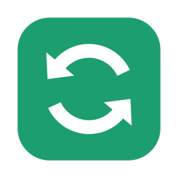
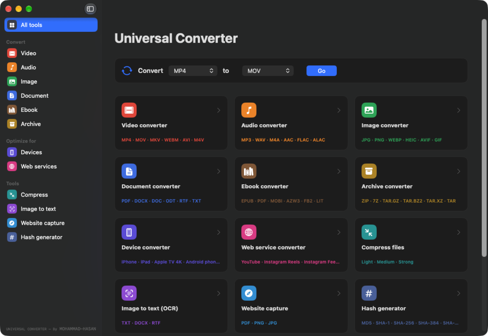
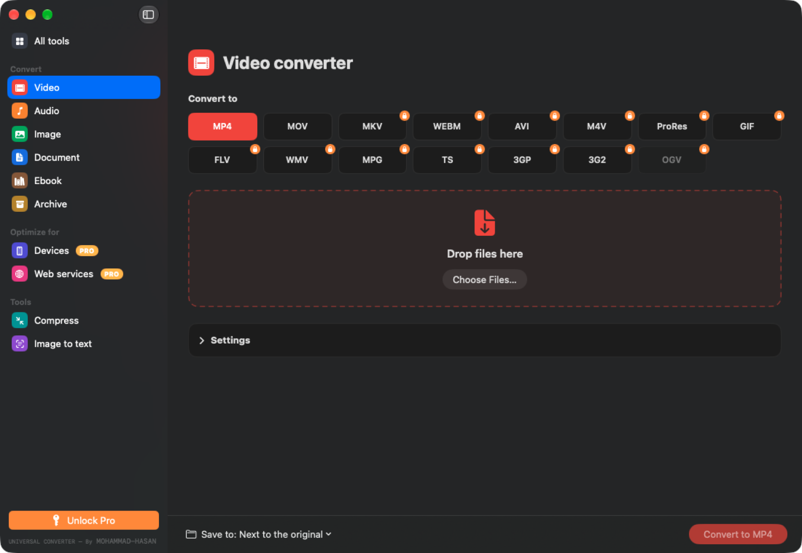
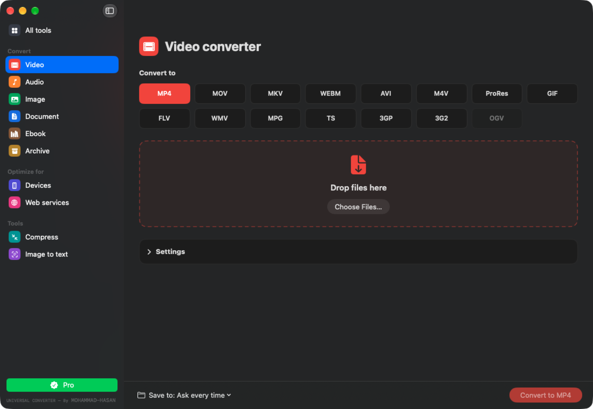
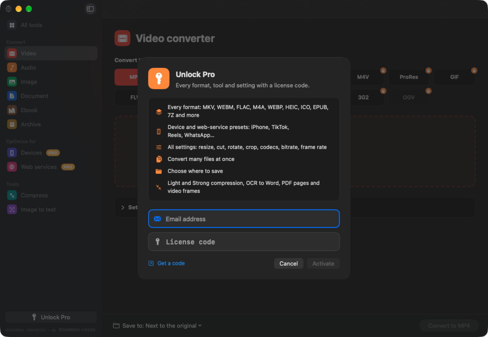
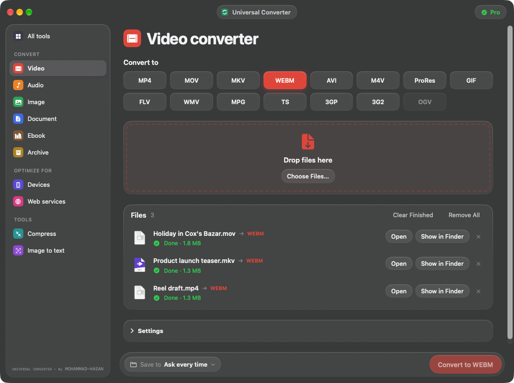
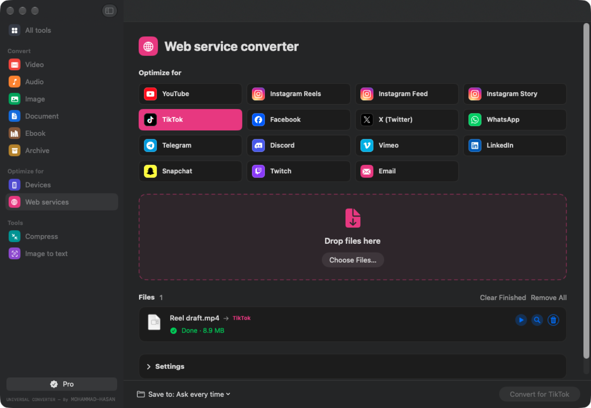

  

<h1 align="center">Universal Converter</h1>

  Convert <b>video, audio, images, documents, ebooks and archives</b>, right on your computer. 
  Native apps for <b>Mac</b> and <b>Windows</b>. Nothing is uploaded, there are no file-size limits, and it works offline. 
  The everyday formats are <b>free</b>. Every other format, tool and setting is <b>Pro</b>, unlocked with a license code.

  <a href="../../releases/latest"><b>⬇ Download the latest version</b></a>
  &nbsp;·&nbsp; <a href="#install">Install</a>
  &nbsp;·&nbsp; <a href="#how-to-use">How to use</a>
  &nbsp;·&nbsp; <a href="#free-and-pro">Free &amp; Pro</a>
  &nbsp;·&nbsp; <a href="#faq">FAQ</a>

  <picture>
    <source media="(prefers-color-scheme: dark)" srcset="docs/home-dark.png">
    <source media="(prefers-color-scheme: light)" srcset="docs/home-light.png">
    
  </picture>

## Features

- **10 tools in one app**, like the online converters, but private:
  video, audio, image, document, ebook and archive converters, device and web-service presets,
  file compression and image to text (OCR).
- **Free and Pro.** MP4, MOV, MP3, WAV, JPG, PNG, PDF, DOCX, ZIP and more are free forever. A Pro license code unlocks
  every other format, tool and setting. See [Free & Pro](#free-and-pro).
- **Drop and convert.** Pick a format, drop a file on the window and press **Convert**. With Pro, convert many files at once.
- **Save where you want (Pro).** Free conversions are saved next to the original. With Pro, choose a folder each time,
  or always save to one folder.
- **Optional settings when you want them:** size, cut, rotate, crop, codecs, bitrate, target file size, frame rate,
  audio channels and sample rate, volume and loudness, image quality, PDF page size and more.
- **Your files stay on your computer.** No uploads, no accounts, no file-size limits.
- **Updates itself.** When a new version comes out, the app shows **Update now**. One click installs it and restarts.
- **Light and dark mode**, matching your system.

## What it converts

| Tool | Formats |
|---|---|
| **Video** | MP4, MOV, MKV, WEBM, AVI, M4V, ProRes, GIF, FLV, WMV, MPG, TS, 3GP, 3G2 |
| **Audio** | MP3, WAV, M4A, AAC, FLAC, ALAC, OGG, OPUS, AIFF, WMA, M4R (ringtone), AC3, or pull the sound out of a video |
| **Image** | JPG, PNG, WEBP, HEIC (Mac), AVIF, GIF, TIFF, BMP, PDF, ICO, ICNS, SVG, TGA, PSD, EXR, JPEG 2000, WBMP. PDFs and videos become images too |
| **Document** | PDF, DOCX, DOC, ODT, RTF, TXT, HTML, Markdown. Merge files and images into one PDF |
| **Ebook** | EPUB, PDF, TXT, DOCX. With the free [calibre](https://calibre-ebook.com): MOBI, AZW3, FB2, LIT, LRF, PDB, TCR |
| **Archive** | ZIP, 7Z, TAR, TAR.GZ, TAR.BZ2, TAR.XZ. Extract ZIP, 7Z, RAR, TAR, GZ, BZ2, XZ |
| **Devices** | iPhone, iPad, Apple TV 4K, Android, PlayStation, Xbox, Nintendo Switch, Smart TV, Kindle Fire, PSP, classic phones |
| **Web services** | YouTube, Instagram (Reels, Feed, Story), TikTok, Facebook, X, WhatsApp (under 16 MB), Telegram, Discord (under 10 MB), Vimeo, LinkedIn, Snapchat, Twitch, Email |
| **Compress** | Videos, images, PDFs and audio, Light / Medium / Strong |
| **Image to text** | Photos, screenshots and scanned PDFs to TXT, DOCX or RTF |

## Free and Pro

The everyday conversions are **free forever**, with no file-size limits and no watermark.
A **Pro license code** unlocks everything else. Pro formats and settings show a 🔒 lock, and the Pro tools an orange **PRO** tag,
until you unlock them.

| Tool | Free | Pro |
|---|---|---|
| **Video** | MP4, MOV, with quality and every sound setting | MKV, WEBM, AVI, M4V, ProRes, GIF, FLV, WMV, MPG, TS, 3GP, 3G2, OGV · resize, codec, bitrate / file size, frame rate, cut, rotate and flip, crop, deinterlace, hardware encoding |
| **Audio** | MP3, WAV, with bitrate, sample rate, channels and volume | M4A, AAC, FLAC, ALAC, OGG, OPUS, AIFF, WMA, M4R ringtone, AC3 · cut, normalize loudness, remove sound |
| **Image** | JPG, PNG, with quality | WEBP, HEIC (Mac), AVIF, GIF, TIFF, BMP, PDF, ICO, ICNS, SVG, TGA, PSD, EXR, JPEG 2000, WBMP · resize, rotate and flip, black and white, remove metadata, PDF pages and video frames to images, combine images into one PDF |
| **Document** | PDF, DOCX, and merging files into one PDF | DOC, ODT, RTF, TXT, HTML, Markdown · PDF page size |
| **Ebook** | PDF | EPUB, MOBI, AZW3, FB2, LIT, LRF, PDB, TCR, TXT, DOCX |
| **Archive** | ZIP, and extracting any archive | 7Z, TAR, TAR.GZ, TAR.BZ2, TAR.XZ · packing several files into one archive |
| **Devices** | | The whole tool |
| **Web services** | | The whole tool |
| **Compress** | Medium | Light, Strong, and a target size for videos |
| **Image to text** | TXT | DOCX, RTF · choosing the language |
| **Whole app** | One file at a time, saved next to the original | Many files at once · choosing where to save |

<table>
  <tr>
    <td align="center"> Without Pro</td>
    <td align="center"> With Pro</td>
  </tr>
</table>

**Get a code.** Message [MOHAMMAD-HASAN on Instagram](https://www.instagram.com/kam_rul_69/). Codes look like `ABCDE-FGHJK`.

**Activate it.** Click **Unlock Pro** at the bottom of the sidebar (on Mac it's also in the app menu), enter your email and the code,
and click **Activate**. You need an internet connection for this step only. Clicking anything with a 🔒 opens the same window.

**How licenses work**

- **One code, one computer.** A code is activated on one Mac or PC at a time. Trying it on a second computer shows which device it's active on.
- **New computer?** On the old one, click **Pro** and then **Remove License**, then activate the same code on the new one.
  If the old computer is gone, message MOHAMMAD-HASAN and the code will be moved for you.
- **Works offline.** After activation Pro keeps working without internet. About once a day the app quietly checks that the code is still yours.
- **What's sent.** Activation sends the code, your email, an anonymous device ID (a one-way fingerprint of your computer's hardware ID, not the ID itself), your computer's name and its type (for example "Mac · MacBook Air (M2, 2022) · macOS 26.0" or "Windows 11 · Dell XPS 13"). That's used only to manage your license. Your files are never sent.
- **Updates keep Pro.** Installing a new version doesn't remove your license.
- **Separate from Universal Downloader.** Universal Converter has its own codes; a Universal Downloader code doesn't unlock it.

## A closer look

**Convert many files at once** (Pro), with progress for each one. ▶ opens the result and 🔍 shows it in its folder.

<picture>
  <source media="(prefers-color-scheme: dark)" srcset="docs/hero-dark.png">
  <source media="(prefers-color-scheme: light)" srcset="docs/hero-light.png">
  
</picture>

**Ready for every platform (Pro).** One click makes a video fit TikTok, Reels, WhatsApp, Discord and more:
the right size, a blurred background for vertical video, and a file small enough to send.

  &nbsp;
  &nbsp;
  &nbsp;
  &nbsp;
  &nbsp;
  

## Install

Get the file for your computer from **[Releases](../../releases/latest)**.

### Mac (macOS 14 Sonoma or newer, Apple Silicon and Intel)

1. Open `Universal-Converter-<version>.dmg` and drag **Universal Converter** onto **Applications**.
2. Open the app. The first time, macOS blocks it because it isn't from the App Store.
   Go to **System Settings → Privacy & Security**, scroll down and click **Open Anyway**. You only do this once.
3. Video and audio need the free ffmpeg engine. If your Mac doesn't have it, the app offers **Install ffmpeg** (one click, about 80 MB).

### Windows (Windows 10 or 11, 64-bit)

1. Download `Universal-Converter-<version>.exe` and put it wherever you like (Desktop, Documents…). There's nothing to install.
2. If **"Windows protected your PC"** appears, click **More info → Run anyway**. You only do this once.
3. Setup starts by itself on first launch. It downloads the free conversion engines (about 150 MB), once.

## How to use

1. Pick a tool on the left: **Video**, **Audio**, **Image**, **Document**… or use **Convert [from] to [to]** on the home page.
2. Choose the format you want.
3. Drop files on the window (or press **Choose Files…**).
4. Open **Settings** if you want to change size, quality, cut and so on.
5. Press **Convert**. Free conversions are saved next to the original; with Pro you choose where to save.
6. Anything with a 🔒 is Pro: click it once and enter your license code ([Free & Pro](#free-and-pro)).

## FAQ

**Are my files uploaded anywhere?**
No. Everything happens on your computer. The only thing that goes online is activating a Pro code (see [What's sent](#free-and-pro)).

**Why does my Mac or PC warn me the first time?**
The app isn't sold through the App Store or Microsoft Store, so your computer doesn't recognise it yet. Approve it once as described in [Install](#install). Updates installed from inside the app normally don't ask again.

**MOBI / AZW3 (Kindle) is greyed out.**
Those formats need [calibre](https://calibre-ebook.com/download), which is free. Install it and reopen the app.

**DOC is greyed out on Windows.**
Old Word `.doc` files need [LibreOffice](https://www.libreoffice.org/download/), which is free. DOCX works without it.

**PDF to Word doesn't look like the original.**
The text and paragraphs come across, but complex layouts, tables and pictures in PDFs aren't rebuilt.

**Image to text can't read my language.**
On Mac, pick the language under Settings. On Windows, text recognition uses the languages installed in
**Settings → Time & language → Language**.

**My license code says "already active on another device".**
Each code works on one computer at a time. Remove it on the other computer first (**Pro → Remove License**), or message
[MOHAMMAD-HASAN](https://www.instagram.com/kam_rul_69/) to move it.

**Does Pro work on both Mac and Windows?**
Yes. The same kind of code works in both apps, on one computer at a time.

**Something I picked shows a lock.**
That format, tool or setting is Pro. Click it to unlock, or pick a free one: for example MP4 instead of MKV, or Medium compression.

## Made by

<samp>UNIVERSAL CONVERTER — By <a href="https://www.instagram.com/kam_rul_69/"><b>MOHAMMAD-HASAN</b></a></samp>

## Built with

- [FFmpeg](https://ffmpeg.org) for video and audio
- Apple's built-in frameworks on Mac (ImageIO, PDFKit, Vision and the Cocoa text system)
- On Windows: [ImageMagick](https://imagemagick.org) (Magick.NET), [pandoc](https://pandoc.org), [Typst](https://typst.app),
  [PDFium](https://pdfium.googlesource.com/pdfium/) (PDFtoImage), [PdfPig](https://github.com/UglyToad/PdfPig),
  [PDFsharp](https://www.pdfsharp.com), [SharpCompress](https://github.com/adamhathcock/sharpcompress), [7-Zip](https://www.7-zip.org),
  [BouncyCastle](https://www.bouncycastle.org/) (license checks) and Windows OCR
- Platform logos from [Simple Icons](https://simpleicons.org) (CC0). All logos are trademarks of their owners.
